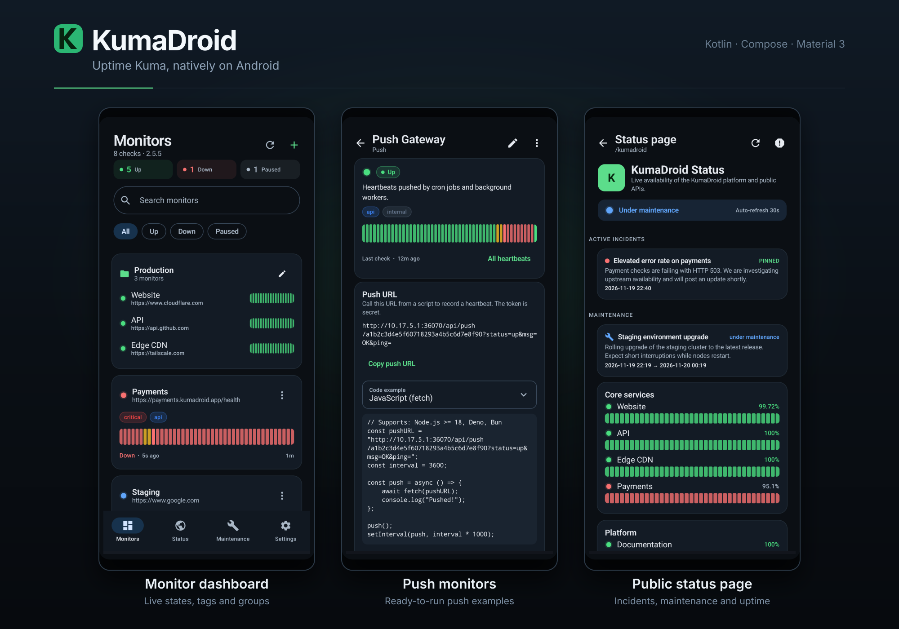

# KumaDroid

Native Android client for [Uptime Kuma](https://github.com/louislam/uptime-kuma). It connects
directly to a Kuma server over Socket.IO, so it does not need a proxy, a plugin, or a separate
backend.

The UI is written in Kotlin and Jetpack Compose. It targets Android 15 (API 35) and supports
Android 8.0 (API 26) and newer.

<p align="center">
  
</p>

<p align="center">
  <sub><a href="docs/screenshots/dashboard.png">Dashboard</a> ·
  <a href="docs/screenshots/production-group.png">Monitor details</a> ·
  <a href="docs/screenshots/push-monitor.png">Push monitor</a> ·
  <a href="docs/screenshots/status-page.png">Status page</a></sub>
</p>

## Features

- First-run server setup, login, remember-me, and TOTP two-factor authentication.
- Dashboard with live monitor states, tags, groups, search, pause/resume, and manual heartbeats.
- Full monitor editor for all Uptime Kuma monitor types, including HTTP, keyword, JSON query,
  TCP, ping, DNS, Docker, system service, PM2, real browser, WebSocket, SFTP, push, manual,
  group, gRPC, Kafka, MQTT, NTP, RabbitMQ, SIP, SMTP, SNMP, Tailscale, GameDig, Steam, SQL
  Server, MongoDB, MySQL, Oracle, PostgreSQL, Radius, and Redis.
- Per-type fields: authentication, TLS, proxies, accepted status codes, keywords, JSON paths,
  DNS records, database queries, SNMP, GameDig games, and notification bindings.
- Monitor details with heartbeat history, ping chart, uptime, response, TLS/domain information,
  push URL and ready-to-run push examples, and real-browser screenshots.
- Monitor events, important-event filters, clear events, and delete.
- Maintenance windows with manual/single/recurring/cron strategies, time windows, timezone,
  monitor selection, status pages, and cloning.
- Status pages with public preview, groups, theme, logo URL, custom CSS, analytics, footer,
  domain names, and incident posts (post, edit, resolve, pin, delete).
- Tags, notification providers and test messages, API keys, Docker hosts, proxies, remote
  browsers, reverse-proxy guide, appearance, general/data/security settings, and About.
- Password changes, TOTP enable/disable, and server-side API key management.

All changes go through the same Socket.IO events and REST endpoints that the official web UI
uses. Unknown monitor fields are preserved when editing, which keeps newer server features safe.

## Requirements

- JDK 17
- Android SDK platform 35 and build-tools 35.0.0
- An Uptime Kuma 2.x server reachable from the device

## Build

A plain Gradle build needs only JDK 17 and the Android SDK:

```bash
cd mobile
./gradlew assembleDebug
```

The APK is written to `mobile/app/build/outputs/apk/debug/app-debug.apk`.

## Test and lint

```bash
cd mobile
./gradlew test lint
```

Unit tests cover JSON normalization, monitor defaults, push-token generation, model mapping,
and monitor-type contracts. GitLab CI and the GitHub Actions workflow run the same checks and
upload the debug APK.

## Run

Install and start the app:

```bash
adb install -r mobile/app/build/outputs/apk/debug/app-debug.apk
adb shell am start -n org.kumadroid.app/.MainActivity
```

On first launch, enter the server URL (for example `https://kuma.example.com`), then sign in.
HTTP is accepted for local testing; production deployments should use HTTPS.

## Architecture

| Path | Responsibility |
| --- | --- |
| `data/KumaSocket.kt` | Minimal Socket.IO/Engine.IO client, authentication, request/ack handling, event fan-out, and automatic heartbeat replies. |
| `data/KumaRepository.kt` | Single source of truth for sessions, server state, Socket.IO events, REST calls, and all mutations. |
| `data/MonitorDefaults.kt` | Server-compatible defaults for every monitor type and push-token generation. |
| `data/KumaModels.kt` | Typed views over the original JSON payload plus tolerant JSON helpers. |
| `ui/Nav.kt` | Stack-based navigator and formatting helpers. |
| `ui/*Screen.kt` | Compose screens; each screen reads repository state and calls repository actions. |

The app keeps the original JSON objects returned by the server. Edit screens work on a deep copy
and send the complete object back, so fields that KumaDroid does not render are not dropped.

Socket.IO protocol details and server behavior were verified against Uptime Kuma 2.5.5. When
upgrading the server, re-check the corresponding upstream `socket-handlers/` and `model/` code.

## Mobile MCP / emulator

The repository includes an `opencode.json` entry for `@mobilenext/mobile-mcp`. Development and
manual verification use a redroid/Android emulator exposed to the MCP server over ADB. See
`AGENTS.md` for the local test workflow.

## Repository

GitLab is the primary repository. GitHub is a read-only push mirror that is updated
automatically; open issues and merge requests on GitLab. Do not commit to the GitHub mirror,
because the next mirror update overwrites its branches.

## License

KumaDroid is free software: you can redistribute it and/or modify it under the terms of the GNU
General Public License as published by the Free Software Foundation, either version 3 of the
License, or (at your option) any later version.

KumaDroid is distributed in the hope that it will be useful, but WITHOUT ANY WARRANTY; without
even the implied warranty of MERCHANTABILITY or FITNESS FOR A PARTICULAR PURPOSE. See the
[LICENSE](LICENSE) file for the full text.
